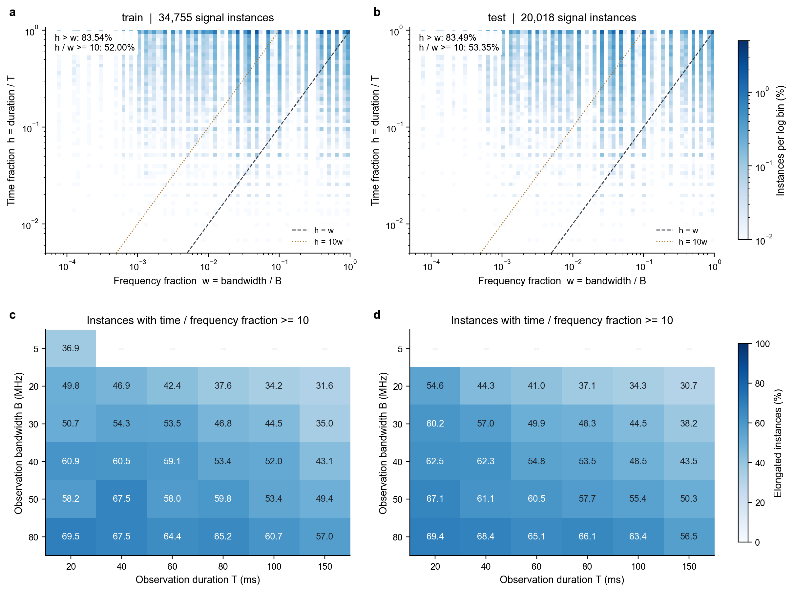

# SpaceNet advanced 数据集与任务理解

当前工作基础是 AutoDL 上导出的 SpaceNet advanced 分析包。任务可表述为：从一段包含多个信号的宽带 IQ 观测中，检测每个信号的频率边界、时间边界，并识别其数字类别。后续研究重点是宽窄带共存、时频框重叠和不同观测尺度下的多实例定位识别。

初次核查已阅读7份核心报告、审查7个分析脚本，并重新聚合主表、复算全部样本的框重叠与并集面积。目前本地已同步服务器的两处汇总修复记录，本次新增尺度统计不改动导出包。本文件记录当前共识、核正结果和后续需要确认的条件，供多个会话继续工作。更新日期为2026年11月17日。

## 数据在哪里及已验证范围

- 本地 `analysis` 是分析导出包，包含主表、派生统计、图和脚本，没有原始 IQ `.bin` 及对应标签 JSON。
- 脚本记录的服务器数据位置为 `/root/autodl-fs/SpaceNet_Dataset/advanced/{train,test}`，分析工作位置为 `/root/autodl-tmp/workspace/spacenet/analysis`。
- 原始样本按同名 `.bin` 与 `.json` 配对。JSON 的 `observation_range` 给出观测频率范围，`signals` 列出每个信号的类别与时频边界。
- 主表记录的 `.bin` 总字节数约102.15 GB。这是服务器导出元数据的加总，并非本地存有这些波形文件。
- 本地能够复核表间一致性、几何公式、分组计数和框重叠；原始 IQ 的格式、波形内容、信噪比和标签与波形的对应关系仍需在服务器确认。

主要依据：[原分析入口](analysis/README.md)、[样本主表](analysis/outputs/samples.csv)、[实例主表](analysis/outputs/instances.csv)、[主表生成脚本](analysis/scripts/build_manifest.py)。其余统计表多由两张主表派生，属于同一数据来源链。

## 输入与输出的具体含义

每个样本是一个观测带宽为 `B`、观测时长为 `T` 的时频画布，包含数量可变的信号实例。当前输出真值是实例集合：

```text
{(start_frequency, end_frequency, start_time, end_time, class)}
```

标签频率按 MHz、时间按 ms 解释，类别暂用 `0–13`，协议名称尚未核定。`signal_id` 是样本内实例标识，不是已经确认的跨样本发射源身份。

当前脚本采用的换算为：

```text
B = f_hi - f_lo                         # MHz
N = bin_bytes // 4                      # 假定每个复采样点4字节
T = N / (B × 1000)                      # ms，隐含 Fs = B MHz
u = (f - f_lo) / B                      # 频率归一化坐标
v = t / T                               # 时间归一化坐标
w = (end_frequency - start_frequency)/B
h = (end_time - start_time)/T
```

本项目现按用户确认的官方说明采用Fs=B，T=N/Fs。每点4字节及具体IQ类型、排列、字节序仍属于数据读取规范；仅查文件大小不能独立核实这些格式信息。

这里的 `u/w` 对应频率、`v/h` 对应时间。若实际谱图横轴为时间、纵轴为频率，转换检测标签时必须交换轴，并检查频率轴是否翻转。

当前包没有源分离波形真值、未知类别定义、SNR 字段、检测训练实现或正式评测协议。现阶段能够据此建立的是14类多信号检测与定位识别任务；源分离、开放集识别和强干扰条件下的性能需要另行定义和验证。

## 数据规模与设计

| 项目 | train | test |
| --- | ---: | ---: |
| 样本数 | 7,500 | 2,500 |
| 信号实例数 | 34,755 | 20,018 |
| 平均实例数每样本 | 4.634 | 8.0072 |
| 每样本信号数取值 | 1、2、3、4、6、8 | 6、8、10 |
| 观测带宽 B MHz | 5、20、30、40、50、80 | 20、30、40、50、80 |
| 观测时长 T ms | 20、40、60、80、100、150 | 20、40、60、80、100、150 |
| 复采样点数范围 | 100,000–12,000,000 | 400,000–12,000,000 |

合计10,000个样本、54,773个实例。5 MHz只对应20 ms，共1,287个样本，全部在train。相同 `N` 可以对应不同 `B/T`，例如1,600,000点可对应20 MHz×80 ms、40 MHz×40 ms、80 MHz×20 ms。

样本 ID、样本内实例键均唯一，逐样本实例数与样本主表声明一致。129个样本比常见点数多1个复采样点；时长按3位小数归格后计数自洽。

测试集更密、更偏向长观测。train 没有10信号样本，test 有836个，占test的33.44%。从train分层抽样或重加权只能匹配共同覆盖范围，无法构造真实的10信号场景；这一部分应明确视为密度外推。


## 类别与尺度

以下计数由实例主表重算，与 `class_counts.csv` 一致。旧版类别表的train/test表头曾颠倒；当前本地版本已同步修复，见[服务器修复记录](analysis/FIX_REPORT_2026-11-17.md)。

| class | train | test | 标签物理带宽特征 |
| ---: | ---: | ---: | --- |
| 0 | 1,573 | 857 | 基本固定20 MHz |
| 1 | 1,597 | 915 | 基本固定20 MHz |
| 2 | 1,596 | 937 | 基本固定20 MHz |
| 3 | 720 | 392 | 基本固定40 MHz |
| 4 | 694 | 380 | 基本固定40 MHz |
| 5 | 728 | 410 | 基本固定40 MHz |
| 6 | 3,472 | 1,962 | 基本固定1 MHz |
| 7 | 3,507 | 2,036 | 基本固定2 MHz |
| 8 | 7,017 | 4,076 | 基本固定2 MHz |
| 9 | 6,899 | 3,947 | 多峰，约0.0523、0.0625、0.25 MHz |
| 10 | 1,770 | 1,040 | 0.3–10 MHz，中位数10 MHz |
| 11 | 1,698 | 1,027 | 1.6–10 MHz，中位数10 MHz |
| 12 | 1,774 | 1,013 | 0.006–0.2 MHz |
| 13 | 1,710 | 1,026 | 0.04–0.2 MHz |

class 8/9合计占40.05%，class 3/4/5各自约占2%，需要逐类报告结果。train/test总体类别比例接近，明显差异主要在场景密度与观测尺度。

标签带宽全局为6 kHz–40 MHz，持续时间为1–125 ms。归一化频宽最小约0.000075。以频率方向640个格点为例，80 MHz画布内6 kHz目标只占 `640×0.006/80=0.048` 个格点；这是标签尺度计算，实际谱图能否看见还取决于STFT参数和波形。不能仅靠将整幅谱图缩放为固定尺寸就假定窄带信息被保留。

跨样本比较 `w` 应控制B，比较 `h` 应控制T，比较面积与纵横比应控制B和T。持续时间更长在固定T下使h增大；测试集总体h较低，需要结合更长的T及二者联合分布解释。

## 重叠与近同框

从实例主表对全部样本重新计算相交框对、每实例重叠数和矩形并集面积，结果与重叠输出一致。

| 指标 | train | test |
| --- | ---: | ---: |
| 至少与其他框二维相交的实例比例 | 66.83% | 76.26% |
| 有相交框对的样本比例 | 73.37% | 94.80% |
| 平均框并集面积占画布比例 | 0.4116 | 0.4960 |
| 相交框对总数 | 24,260 | 20,397 |
| 近同框对 IoU≥0.999 | 220 | 118 |

近同框共338对，涉及294个样本、619个实例，同类192对、跨类146对。其中337对IoU为1，1对约为0.999994。是否属于同频多源共存、同类多源或重复标注，几何统计本身无法判定，应保留原标签并核查生成机制。

这些指标描述的是标注矩形几何。框重叠不直接量化信号干扰强度，框并集面积也不等于真实频谱能量占用率。NMS和匹配策略需考虑同位置多实例的合法可能性，暂不静默去重或合并。

## 原分析中需要修正和限定的内容

| 原位置 | 核查结果及后续采用口径 |
| --- | --- |
| `DATASET_ANALYSIS.md` 第5节类别表 | 旧版train/test计数列颠倒；当前本地已同步修复。生成逻辑显式指定列序，实例主表重算与当前表一致。 |
| `quality_summary.json` 的 `duration_counts` | 旧版因浮点键格式化覆盖，合计仅7,604。当前已按设计时长保留3位小数归组修复，合计10,000；100 ms为1,260、150 ms为1,220。原始精确时长不变。 |
| 物理时长更长导致h降低的解释 | 应按 `h=dur/T` 联合解释，不能只看分子。 |
| 完全相同框的称谓 | 脚本阈值为IoU≥0.999，统一称近同框，并保留阈值。 |
| 未发现数据泄漏的表述 | 只确认53组、191个相同JSON样本均在train，服务器记录显示这些组内没有相同bin哈希。未做全部IQ的全局精确和近重复核查。 |
| 5 MHz屏蔽class 10/11的建议 | 目前只证实这两类在5 MHz样本中未出现；其最小标签带宽小于5 MHz，不能据此判定物理不可能。硬屏蔽需生成规则或官方约束支持，当前仅可作为待验证的经验先验。 |
| 验证集模拟测试集的建议 | 共同覆盖范围可按B/T/密度分层；train缺失10信号场景，需单独报告外推结果。 |
| class与B的强相关表述 | V约0.12–0.15，宜表述为存在关联并结合物理范围与生成设计解释。实例级检验未处理样本内依赖，多重比较和极小p值不宜过度解读。 |

原包按自身口径未发现边界越界、起止顺序或类别范围错误；14,842个小框占27.10%，标记条件为 `w<0.01 或 h<0.01`，这是尺度标记，不能当作坏样本删除。未发现这些结构错误也不等于标签已与真实波形逐一核验。

## 后续工作的共同起点

1. 先确认原始信号规范：IQ类型、字节序、I/Q排列、实际采样率、时间单位、类别名称，以及数据生成和切分规则。
2. 对近同框与典型窄带样本检查原始IQ、标签和谱图，确定合法多实例与标注策略。
3. 在6 kHz目标带宽、80 MHz观测带宽等边界条件下检查表示的分辨能力，再决定STFT、多分辨率或其他输入表示。
4. 只在train内部建立可复现验证划分，按B/T/密度分层，并关注重复布局分组；明确10信号场景的覆盖缺口。
5. 确定定位与识别的评测协议、逐类及逐场景结果、近同框匹配规则，再进入基线训练和方法比较。

以上是后续研究顺序，当前尚未执行训练、划分验证集或改变标签。本项目已有的WBSig53、JDM、窄带感知论文可作为方法参照；SpaceNet统计与这些论文各自实验结果保持明确来源。

## 继续阅读的入口

- [原总体分析](analysis/FINAL_ANALYSIS.md)：结合本文件的核正项阅读。
- [画布与规模](analysis/DATASET_ANALYSIS.md)、[物理尺度与归一化几何](analysis/GEOMETRY_ANALYSIS.md)。
- [类别构成](analysis/CLASS_MIX_ANALYSIS.md)、[框重叠](analysis/OVERLAP_ANALYSIS.md)、[训练测试差异](analysis/SHIFT_ANALYSIS.md)。
- [样本主表](analysis/outputs/samples.csv)、[实例主表](analysis/outputs/instances.csv)：重新统计的主要入口。
- [近同框清单](analysis/outputs/exact_overlap_pairs.csv)、[重复核查范围说明](analysis/outputs/duplicate_check_summary.json)。

原分析脚本使用服务器路径，多数脚本加载时即执行读写。本地阅读阶段不要直接运行或导入，以免覆盖原件；实际复现时再适配明确的数据和输出位置。

## 归一化尺度统计与STFT格点分配

结论：本数据多数实例的归一化时间长度大于频率宽度，支持沿频率轴配置更多格点的研究方向。宽带类仍需要保留时间定位能力；格点覆盖改善尚不是谱图或模型性能改善的证据。

### 数据与统计口径

本节由当前本地样本主表和实例主表重新计算，覆盖train的7,500个样本、34,755个实例，以及test的2,500个样本、20,018个实例。没有读取原始IQ、运行实际STFT或训练模型；没有去重或忽略任何近同框标签。

频率相对宽度记为w=实例带宽/B，时间相对长度记为h=实例持续时间/T，窄长程度记为r=h/w。r在每个实例上单独计算，中位数r不等于中位数h除以中位数w。所有主表中的归一化值都保留原始精确T；仅分组时将T保留3位小数。

主统计每个实例权重相同；另报告先在样本内求比例、再对样本等权平均的结果。阈值比较使用相对容差1e-9，避免本应等于1、4或10的值因浮点误差被分到错误一侧。没有使用该容差改写原始边界。

用户已确认官方介绍给定Fs=B，本项目据此采用该关系。以下继续以“观测带宽B”和“观测时长T”标识离散组合；B换为Hz后即可用作采样率，T=N/B。

### 整体分布

| 指标 | train | test |
| --- | ---: | ---: |
| 频率相对宽度w中位数 | 5.00% | 4.00% |
| 时间相对长度h中位数 | 56.67% | 52.00% |
| 每实例r=h/w中位数 | 10.40 | 11.50 |
| h>w的实例比例 | 83.54% | 83.49% |
| h≥4w的实例比例 | 64.72% | 67.28% |
| h≥10w的实例比例 | 52.00% | 53.35% |
| h≥100w的实例比例 | 18.25% | 19.10% |
| 样本等权的h>w平均比例 | 83.50% | 83.47% |
| 样本等权的h≥10w平均比例 | 48.21% | 53.41% |
| 映射640格频率轴后不足1格的实例 | 7.90% | 8.64% |
| 映射640格频率轴后不足4格的实例 | 20.29% | 21.80% |
| 映射640格时间轴后不足4格的实例 | 0.00% | 0.00% |

样本等权和实例等权均支持“多数实例频率窄、时间长”。在640×640画布上，两轴标签尺寸的困难明显不对称；这些比例描述的是标签尺寸，不能直接解释为检出率或信息丢失率。

### 按观测带宽B分层

下表为各B内原有T与类别构成下的边际统计。B和T联合控制的61个实际组合另见图和完整明细；不能把边际变化直接解释为B的单独因果效应。

| B MHz | train w中位数 | test w中位数 | train h中位数 | test h中位数 | train r中位数 | test r中位数 |
| ---: | ---: | ---: | ---: | ---: | ---: | ---: |
| 5 | 20.00% | 无样本 | 100.00% | 无样本 | 3.50 | 无样本 |
| 20 | 10.00% | 10.00% | 58.33% | 52.67% | 6.80 | 6.50 |
| 30 | 6.67% | 6.67% | 56.67% | 51.67% | 9.00 | 9.75 |
| 40 | 5.00% | 5.00% | 52.50% | 53.00% | 12.67 | 12.42 |
| 50 | 4.00% | 4.00% | 53.75% | 51.33% | 15.00 | 15.42 |
| 80 | 2.50% | 2.50% | 52.50% | 50.67% | 25.00 | 25.27 |

### 按观测时长T分层

| T ms | train w中位数 | test w中位数 | train h中位数 | test h中位数 | train r中位数 | test r中位数 |
| ---: | ---: | ---: | ---: | ---: | ---: | ---: |
| 20 | 6.67% | 4.00% | 95.00% | 90.00% | 10.00 | 18.00 |
| 40 | 4.00% | 4.00% | 70.00% | 65.00% | 15.50 | 15.00 |
| 60 | 4.00% | 4.00% | 56.67% | 56.67% | 13.00 | 12.33 |
| 80 | 4.00% | 4.00% | 48.75% | 48.75% | 11.50 | 11.06 |
| 100 | 4.00% | 4.00% | 43.00% | 42.00% | 9.50 | 9.50 |
| 150 | 4.00% | 4.00% | 31.33% | 31.33% | 7.00 | 7.03 |

T增加时，实例在归一化时间轴上的长度整体减小；因此，向频率轴倾斜格点的程度也需要考虑T，不能对所有样本固定使用同一种极端长宽比。

### 类别差异

| class | train r中位数 | test r中位数 |
| ---: | ---: | ---: |
| 0 | 0.95 | 0.83 |
| 1 | 0.88 | 0.83 |
| 2 | 0.96 | 0.80 |
| 3 | 0.72 | 0.65 |
| 4 | 0.75 | 0.72 |
| 5 | 0.70 | 0.73 |
| 6 | 17.60 | 19.50 |
| 7 | 9.20 | 9.69 |
| 8 | 8.93 | 9.30 |
| 9 | 126.67 | 143.33 |
| 10 | 3.00 | 3.00 |
| 11 | 2.29 | 2.40 |
| 12 | 157.92 | 150.00 |
| 13 | 150.00 | 159.03 |

class 9、12、13最支持窄长假设；class 0–5的中位数r小于1，说明宽带目标的时间轴仍是重要约束。不能只用总体中位数决定全部目标的最合适表示。



图中a、b为全部实例的w/h对数分箱分布，每个split独立归一化为百分比；虚线表示h=w，点线表示h=10w。c、d每格为对应B×T组合内h≥10w的实例比例，空白“--”表示该组合不存在，不代表0。分组样本数、实例数见完整CSV。本图为全量描述统计，未进行抽样推断或显著性检验。

### 对STFT格点分配想法的推导

考虑复数IQ、双边FFT、Fs=B、无重叠、无补零，窗长和FFT点数同为L。忽略尾部不足一窗及边界效应时，频率格数F=L，时间格数K≈N/L，因此FK≈N。

一个归一化尺寸为(w,h)的实例，占据的频率格数和时间格数约为：

$$
p_f=wL,\qquad p_t=hN/L.
$$

用“一格误差相对于目标自身尺寸”衡量，两轴相对量化误差分别约为1/p_f和1/p_t。在等权、单目标、连续格点的简化准则下，平衡这两种误差得到：

$$
p_f=p_t\quad\Longrightarrow\quad
L^*=\sqrt{Nh/w},\quad K^*=\sqrt{Nw/h},\quad F/K=h/w.
$$

所以r=h/w越大，合理的频率格数越应多于时间格数。这是任务尺度指导下的资源分配准则，不是对真实谱分辨率或检测最优性的证明。

同时有p_f p_t=whN。调整L只是改变两轴分配；若希望两轴至少各占q格，需要q/w≤L≤hN/q，因而至少要求whN≥q²。这一必要条件只属于当前理想格点模型，不能推广成模型识别能力的信息论界限。

本数据采用官方给定的Fs=B。推广到Fs不等于B的数据时，观测频带内F≈BL/Fs，应按实际采样率重新换算。STFT频率间隔、窗长与步长的定义可参照[SciPy官方说明](https://docs.scipy.org/doc/scipy/reference/generated/scipy.signal.ShortTimeFFT.html)。

原始IQ包含可供频域分析的信息；保留全部复数系数的全局FFT可逆，也没有彻底丢失时间信息。这里的两个极端应理解为显式时频定位方式的不同；后续取幅度、功率、压缩和下采样才会进一步改变可用信息。[NumPy逆FFT说明](https://numpy.org/doc/stable/reference/generated/numpy.fft.ifft.html)

### 原生格点的几何评估

以“两轴标签尺寸均≥4格”作为一个透明的诊断阈值，比较三种无重叠、无补零的连续理想分配。每个样本的格点预算是自身N，样本之间预算不相同。形状先验均只从train估计；test不参与设定先验。

| 分配规则 | train两轴均≥4格 | test两轴均≥4格 |
| --- | ---: | ---: |
| F=K=√N | 86.02% | 86.58% |
| F/K=全train的r中位数10.4 | 96.90% | 96.92% |
| F/K=各B×T组的train r中位数 | 97.92% | 98.12% |

train的31个B×T组合中，形状先验r中位数范围为3.5–40。它是初步启发式，不是优化得到的最佳参数，更不能在推断时读取待检测实例的真实框来决定L。后续可以用train的尺寸分布制定按B/T条件化的规则，再固定规则做验证。

本表未真正执行FFT，未处理整数窗长、窗函数主瓣、频谱泄漏、尾部覆盖、实际功率谱及输入缩放；两轴均≥4格也不是充分的可检测条件。

### 与最终正方形输入的关系

若最终将整段画布直接缩放到640×640，标签尺寸仍为640w和640h，不因原生STFT先生成更多频率格点而改变。高分辨率STFT可能改善前端估计，但其细节是否被后续缩放保留需要实测。要让频率轴预算在模型端继续发挥作用，可以研究矩形输入、分频带裁块或保留高频率分辨率的分支。

另作一个独立的固定409,600格输出预算比较。下表不对应固定N的原生STFT，也不保证相同实际计算成本。

| 频率格F×时间格K | train两轴均≥4格 | test两轴均≥4格 | train时间不足4格 | test时间不足4格 |
| --- | ---: | ---: | ---: | ---: |
| 640×640 | 79.71% | 78.20% | 0.00% | 0.00% |
| 1280×320 | 86.43% | 85.45% | 0.08% | 0.13% |
| 2560×160 | 91.45% | 90.55% | 0.71% | 0.91% |
| 5120×80 | 94.54% | 93.89% | 2.45% | 2.77% |

数据支持研究频率方向倾斜的分配，但也显示时间格数持续减少会增加短时目标风险。不能仅凭本表选择最终尺寸；应检查边界误差、频谱可分辨性、类别内结构、预处理及特征层下采样。

加入重叠时，时间列间隔由hop/Fs决定，列数可多于N/L，但窗口仍影响实际时间模糊；加入补零可增加显示格点，不会自动增加真实谱分辨力。输出格点数相同也不等于FFT运算量或模型计算成本完全相同。

### 明细与复核

- [归一化尺度统计](归一化尺度统计.csv)：888行分组记录，含overall、B、T、B×T、class、B×T×class，所有结果按train/test分开，带样本数、实例数和分位数。
- [STFT格点分配评估](STFT格点分配评估.csv)：区分原生理想格点、固定输出预算及新增的物理窗长方案，含多个阈值和各类分组。
- [数据来源与核查口径](归一化尺度核查.json)：主表SHA256、容差、权重、train形状先验及假设。
- [可编辑统计图](归一化尺度分布.svg)。
- [复算脚本](normalized_scale_analysis.py)：统计和绘图为独立模式，均不读取IQ、不运行训练。

此次保留全部原始实例。主键、逐样本实例数、归一化公式、分组总量和源文件一致性均已检查；图中包含全部54,773个实例；PNG已查看，SVG已核查文本可编辑。

## STFT前端的最低格数约束与推荐方案

本方案只决定STFT前端的物理窗长、FFT点数和步长，不涉及分块、模型输入尺寸或正式训练。Fs=B采用用户确认的官方数据前提。方案参数由train的尺度支持确定，test只用于描述固定规则的覆盖；原始IQ与标签未修改。

以尽可能完整覆盖为目标时，推荐两个物理窗：短窗0.125 ms，长窗0.7 ms，先以每轴4格为目标。它在当前标签数据上覆盖了所有“可由某一无重叠、无补零窗长达到4×4”的实例；少数本身不满足该几何条件的目标单独记录，不删除。若接受逐类约95%的几何覆盖，0.7 ms单窗是较简洁的工程候选，详见[SAHI与模型尺寸综合方案](SAHI与模型尺寸综合方案.md)；该后续研究同时评估切片、模型缩放及计算成本。

### 先把最低格数改写为窗长的可接受区间

令B以Hz计、T以秒计。样本N=BT。一个实例的绝对带宽为b Hz，持续时间为d秒；相对尺度是w=b/B、h=d/T。

用W表示窗长点数，M表示FFT点数，H表示滑动步长，τ=W/Fs表示物理窗长。先取M=W、H=W，无重叠、无补零，忽略边界。此时：

$$
\Delta f=1/\tau,\qquad \Delta t=\tau,\qquad
p_f=b\tau,\qquad p_t=d/\tau.
$$

要求频率轴至少q_f格、时间轴至少q_t个窗长尺度，可接受窗长必须满足：

$$
\boxed{\frac{q_f}{b}\le\tau\le\frac{d}{q_t}}.
$$

等价的归一化表达是：

$$
\frac{q_f}{w}\le W\le\frac{hN}{q_t}.
$$

这把“平衡两个平均尺度”改成了“满足各实例的最低要求”。某实例存在可行窗长，当且仅当：

$$
\boxed{bd\ge q_fq_t}.
$$

这里的格数是DFT频率栅格和窗长时间尺度的几何预算，不是独立有效分辨单元，更不是检测性能的保证。

### B和T怎样进入分配

固定物理窗τ仍会生成不同矩阵：

$$
F=B\tau,\qquad K\approx T/\tau,\qquad F/K=B\tau^2/T.
$$

于是相同物理实例无论放进何种B/T画布，所占格数仍是bτ和d/τ。它的归一化尺寸变化，由矩阵两轴格数的相应变化补偿。这同时利用绝对和相对尺度，不需要为31个B×T组合分别设置没有物理含义的形状系数。

例如τ=0.125 ms时，1 MHz信号在10 MHz样本上占0.1×1250=125格，在80 MHz样本上占0.0125×10000=125格。观测带宽不同，实际频率栅格间隔仍相同。T改变主要改变列数，而非被迫改变同一实例的物理分辨率。

先前按median(h/w)平衡两轴的规则仍可作对照，但没有直接优化最低格数覆盖，也可能掩盖稀有窄带群体。

### 为什么主推荐需要两个窗

训练标签的带宽支持中，极窄的一组为约6 kHz，其余实例带宽均至少约40 kHz；全局最短实例约1 ms。

以q_f=q_t=4为目标：

- 6 kHz目标要求τ≥4/6000秒，即至少约0.667 ms。
- 1 ms短时目标要求τ≤1/4 ms，即至多0.25 ms。

这两种目标在同一数据集中存在，故不存在一个固定物理窗同时覆盖所有这两类需求。即使每个B/T组合另选一个单窗，组合内的多种尺度也可能互相制约。

对多个目标，可将每个可接受区间I_j=[q_f/b_j,d_j/q_t]标在物理窗长轴上。单窗选择应最大化被同一点τ击中的加权区间数；类别宏平均可防止大类淹没小类。多窗则寻找少数窗长，使可接受区间至少被其中一个窗击中。

当前数据用两个窗已覆盖所有非空可接受区间，而单窗无法满足上述互斥要求。因此“两窗”是在该数据、该几何判据下达到可行上界所需的最少视图数。这不表示它是任意未来数据或实际识别任务的全局最优算法。

### 具体参数

| 项目 | 短窗视图 | 长窗视图 |
| --- | ---: | ---: |
| 目标物理窗长τ | 0.125 ms | 0.7 ms |
| 无补零DFT间隔 | 约8 kHz | 约1.429 kHz |
| 40 kHz目标频率格数 | 约5 | 约28 |
| 6 kHz目标频率格数 | 约0.75 | 约4.2 |
| 1 ms目标的窗长时间尺度数 | 约8 | 约1.43 |
| 3 ms目标的窗长时间尺度数 | 约24 | 约4.29 |

短窗保留短时目标定位能力，也足以让当前非6 kHz群体满足最低频率格数；长窗补充极窄目标。两个完整视图均生成，不根据未知目标真值挑选输入。覆盖定义为“至少一个视图同时满足两轴要求”，不允许把短窗满足的时间轴和长窗满足的频率轴拼成一次通过。

点数取W=2ceil(Fsτ/2)、M=W。下表给出q=4的具体点数；Fs以MHz列示，换算时乘10^6。

| B=Fs MHz | 短窗W=M | 长窗W=M | 短窗半窗步长H | 长窗半窗步长H |
| ---: | ---: | ---: | ---: | ---: |
| 5 | 626 | 3500 | 313 | 1750 |
| 20 | 2500 | 14000 | 1250 | 7000 |
| 30 | 3750 | 21000 | 1875 | 10500 |
| 40 | 5000 | 28000 | 2500 | 14000 |
| 50 | 6250 | 35000 | 3125 | 17500 |
| 80 | 10000 | 56000 | 5000 | 28000 |

5 MHz短窗取偶数后为0.1252 ms，其余均等于标称物理窗长。FFT点数不必是2的幂；后续若为速度选择附近长度，需重新核查两个格数条件，不能只补零后把显示格数当作分辨率收益。

时间列数随T变化。无重叠时，短窗约有160、320、480、640、800、1200列；长窗约有28.6、57.1、85.7、114.3、142.9、214.3列，分别对应T=20、40、60、80、100、150 ms。这些是忽略整数帧与边界的近似值；5 MHz短窗按0.1252 ms计算。

### 全量标签复核

实际整数W、M=W的q=4结果：

| 方案 | train总体覆盖 | test总体覆盖 | train class12覆盖 | test class12覆盖 |
| --- | ---: | ---: | ---: | ---: |
| 仅短窗0.125 ms | 98.2103% | 98.3065% | 64.9380% | 66.5350% |
| 仅长窗0.7 ms | 97.7989% | 98.0268% | 97.8579% | 97.5321% |
| 两窗至少一个同时通过两轴 | 99.96835% | 99.96004% | 99.37993% | 99.21027% |

双窗通过train 34,744/34,755实例，test 20,010/20,018实例。其余13类全部通过几何判据。所有B×T组均检查，最差组为train的50 MHz×150 ms（99.79960%）和test的30 MHz×60 ms（99.71182%）。

剩余train 11个、test 8个实例均属于class12，带宽约6 kHz、持续约1–2 ms。例如6 kHz×2 ms的bd=12<16，可接受区间[0.667 ms,0.5 ms]为空。改变无重叠窗长不能让它同时满足4×4；它仍可能被识别，不应删除，也不能据此宣布不可检测。

### 3至5格的敏感性

短窗统一保持0.125 ms，只改变长窗：

| 每轴最低格数q | 长窗ms | train双窗几何覆盖 | test双窗几何覆盖 |
| ---: | ---: | ---: | ---: |
| 3 | 0.5 | 99.99712% | 100.00000% |
| 4 | 0.7 | 99.96835% | 99.96004% |
| 5 | 0.9 | 99.91080% | 99.93006% |

三组均达到当前数据各自bd≥q²的逐实例任意窗长可行上界。它们属于三套不同要求；q=4主方案不自动宣称达到5格标准。

### 窗函数、重叠和预算

建议实现时采用周期Hann窗、M=W、复数IQ双边居中频谱。无重叠H=W用于上述资源与尺度基准；实际可采用H=W/2，改善滑动采样与边界连续性。覆盖复核仍按d/τ，不利用重叠使列数翻倍来抬高主覆盖数字。

如果用户的“4像素”仅指实际重叠谱图的显示格数，则时间条件应改为d/(H/Fs)≥4。本推荐50%重叠的双窗在该口径下达到train 34,754/34,755（99.99712%）、test 20,018/20,018（100%）。例如6 kHz、2 ms目标在0.7 ms窗、0.35 ms步长下约占4.2×5.71个显示格，满足显示像素预算，但仅跨约2.86个窗长尺度。两种口径均记录，不能据重叠显示格数推断获得同等数量的独立时间信息。此前19个例外只针对无重叠窗长尺度判据，不是对所有重叠STFT的否定。

仅满足显示像素要求还存在更简单的单视图构造：τ=0.7 ms、时间步长H/Fs=0.25 ms，可使当前最窄6 kHz目标占约4.2个频率格、最短1 ms目标占4个时间列，全部标签都可满足显示尺寸下限；输出约2.8N个系数。但1 ms目标仍只跨1.43个窗长，窗口引起的时间平滑不会随列数增加自动消失。因此双窗推荐包含了额外的时间定位保真考虑，不是“只有4显示像素”这个条件的唯一解。若未来选择单长窗高重叠方案，应单独验证短时边界，而不能仅凭显示覆盖率认定trade-off已解决。

Hann窗会展宽谱峰，栅格间隔不等于可分辨距离。周期Hann的ENBW约为1.5/τ，因此6 kHz目标在0.7 ms长窗下虽占4.2个DFT格，仅约占2.8个ENBW宽度。ENBW也不是任意重叠信号可分辨性的充分条件。[SciPy窗函数与谱分析说明](https://docs.scipy.org/doc/scipy/tutorial/signal.html)

作为另一个更严格的频域诊断，可要求bτ/1.5≥4，同时保留d/τ≥4。此时用0.15 ms+1 ms双窗，train/test覆盖分别为99.92231%/99.93006%。这套ENBW归一判据单独记录，不能与主方案的DFT格数口径混用。

对整段N点样本，忽略边界：

- 单窗、无重叠：约N个复数系数。
- 双窗、无重叠：约2N个复数系数。
- 双窗、50%重叠：约4N个复数系数。

因此双窗的收益有额外表示与计算成本。若总输出被严格限制为单视图的N格，应采用单窗并如实接受部分目标不满足格数要求，或重新制定预算；不能将双窗上界当作N格内免费获得的收益。

双窗可作为接近完整几何覆盖的参照。经后续工程成本讨论，用户确定当前以**0.7 ms单窗**起步，M=W；双窗作为后续改良。用户提供的尺寸图采用无重叠H=W、只取完整帧，50%重叠H=W/2为待比较方案。q=4保守判据下，该单窗train总体覆盖97.7989%、最差类别96.2536%，这是标签尺度覆盖，不是检测精度。没有读取原始数据集IQ或启动正式训练；本轮补做了合成IQ与随机模型的无训练核查。

用户已要求制定供OpenCode开工的计划。当前执行入口是[Baseline执行计划](Baseline执行计划.md)：统一`[n,1,2048,512]`、0.7ms窗、精确512列、频率细片及全频粗功率视图。执行模型为**YOLO11s-C1-DirectReg**：保留YOLO11s主体，首层C1、14类、reg_max=1、end2end=False。原因是默认DFL16和最大stride32的框单轴跨度小于约960输入像素，不能只凭2048高矩形前向成功就直接用于所有宽带框。直接回归分支已在本机用随机张量通过前向、完整高框解码、有限loss/梯度检查，优化器步数0；服务器仍须复核。原固定hop分桶、C2、RT-DETRv2-S及RTMDet留作后续对照。

服务器缩容后的最新反馈：4090 24564MiB、16vCPU配额、120GiB内存；本地盘总50GB、空闲约41GB，文件存储空闲约105GB；Torch2.8+cu128/Torchvision0.23，Ultralytics/SAHI尚未安装。复用服务器现有split_manifest.csv（fit5957/val1543/test2500），不另生成10%划分；本地未持有清单，来源是用户转述的服务器核查。研究文件用户已补传，阶段0核对可读性，必要断言在服务器重现。

新512列全量complex64约992.88GiB、native log16约248.22GiB；默认on-the-fly。native磁盘缓存默认关闭，必要时上限为min(12GiB,实际空闲字节−27GiB)，下限0；不建全量coarse磁盘缓存，始终保留至少20GiB空闲。原IQ约102.15GB，不复制全套至本地盘。DirectReg/C1/14类、完整loss/backward/AMP及全val成本须在服务器验收，之后按执行计划推进首场训练；本地未启动服务器运行。

统一512列的最小常规STFT方案：L=Fs×0.7 ms、FFT点数M=L，取h=ceil(N/511)，将IQ末尾补到N_ext=511h，再用center=True、pad_mode=constant得到精确512列。全10,000样本公式核查通过，3个合成IQ代表案例实际通过；当前额外IQ补零时长最大31.2微秒。保留真实N/T与实际h用于坐标还原，不将这点边界扩展算成真实观测。频率Sf=2048，20%重叠、步长1639，末片回贴F−2048：所有F≥3500，每片无需频率图像补边，也不必为凑整增加FFT补零。Sf=2048时仍有27.2853%的train实例自身宽于片，完整任务保留全频粗功率视图。

详见[STFT、频率切片与检测网络张量适配报告](SAHI与模型尺寸综合方案.md)。本机已有PyTorch2.14 CPU/Ultralytics8.4.155环境；除前期16组STFT、12次双通道和2次单通道前向外，新增C=1/2、2048×512随机YOLO11s前向与完整stage hook，输出均为[1,18,21504]且有限。新增统一512列的全样本公式核查与3组实际合成STFT，记录于[张量链路核查](张量链路核查.json)。没有安装/升级环境、下载预训练权重或执行优化器步骤；真实Dataset、训练/验证/预测adapter、全局合并与4090成本尚待服务器核查。

### 参数查表与证据

- [31个B×T组合的物理窗长配置](STFT物理窗长配置.csv)：两窗的W、FFT点数、半窗步长、频率间隔、近似时间列数和train/test覆盖。
- [格点分配评估](STFT格点分配评估.csv)：family为physical_window的新增记录，按overall、B、T、B×T、class分层，包含q=3/4/5与ENBW代理。
- [核查记录](归一化尺度核查.json)：保留两张主表哈希、19个q4残余实例、逐类覆盖及完整规则。
