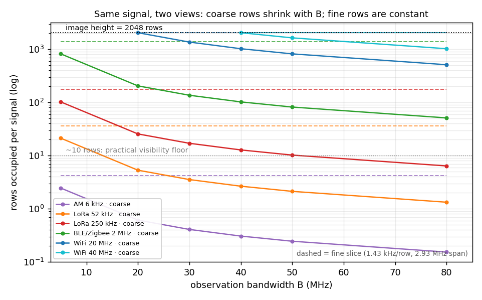
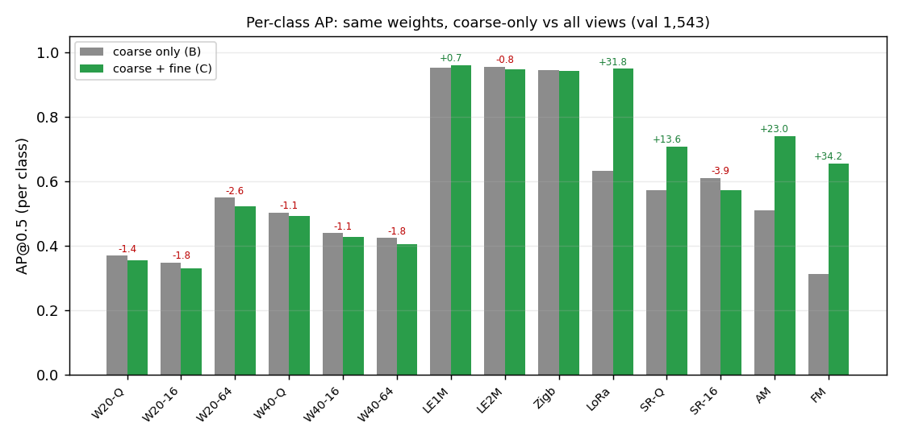
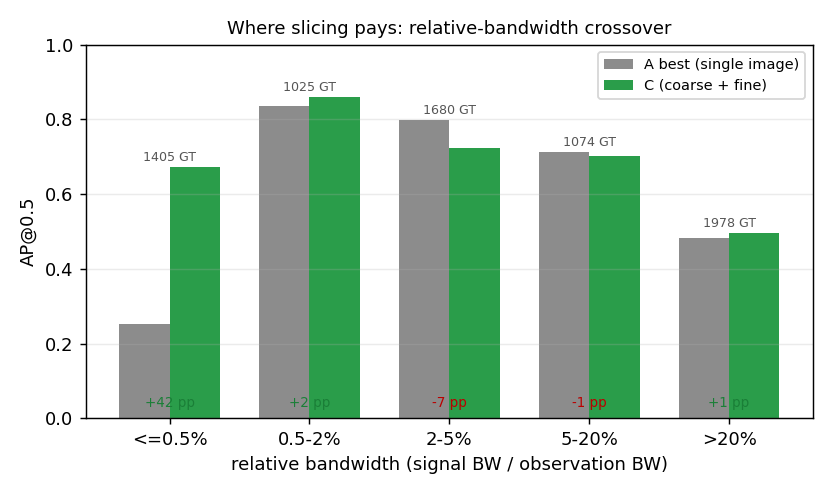

# Baseline-1 复盘：全频粗图＋频率细片的动机、证据与边界

2026-11-22。本报告独立整理自服务器上的一手运行工件与代码，写作基线为
`origin/main` `b8b8212`；核心实验运行于 2026-11-18（训练日志、验证工件、
权重均保留）。**本轮没有新训练、没有新推理**，所有复算只用 CPU 读取已保存
的验证预测、JSON/CSV 工件与标签，官方 test（2,500 样本 / 20,018 实例）
继续封存。文中用 **【实测】** 标记可直接追到工件的数字，**【解释】** 标记
我对机制的理解，**【待验证】** 标记仍需实验才能确认的判断。

---

## 0. 一页结论

1. **同权重、只切换视图集**：粗图单独推理（B）mAP@0.5 = 0.5794；加入细片
   全视图（C）= 0.6427，**+6.33 pp**。这是最干净的因果对照——权重、训练、
   评测完全相同，只改推理时看不看细片。**【实测】**
2. **独立训练的全频单图（A）**：末轮 0.5404、最佳轮 0.5763。对 A 最佳
   +6.64 pp（对末轮 +10.23 pp）。A 与 B 的差异只有 0.31 pp，落在单 seed
   的 checkpoint 噪声内，说明**联合训练本身没有把粗图分支练得更好**，
   系统增益来自推理时的细片。**【实测 + 解释】**
3. **收益不是均匀的**：14 类里只有 5 类为正贡献，9 类持平或略降。LoRa 9、
   FM 13、AM 12 三类合计毛增益 +6.36 pp，SRRC-QPSK 10 再 +0.97 pp；其余
   9 类合计 −1.05 pp。**净增益几乎全部由“窄带定位”贡献**。**【实测】**
4. **收益是定位，不是分类**：以类别无关 IoU≥0.5 计，窄带 9/12/13 未被定位的
   GT 从粗图 719 个降到全视图 181 个；而 WiFi 0–5 的 GT 覆盖在三臂完全相同
   （粗图本来就 96.6–97.0%），其分类准确率 B 与 C 精确相等。**【实测】**
5. **什么时候收益很小**：相对带宽 ≥2% 的信号、BLE/Zigbee（早已饱和）、
   WiFi 家族（大类定位好、小类分类难）、以及 medium 组里 1.6–2 MHz 的
   SRRC-16 子集——后者只有 57 个 GT，却足以让“单图在 medium 更强”的
   旧表述失真。**【实测 + 解释】**
6. **代价**：验证集平均 16.19 视图/样本（B=80 MHz 时 35 个）；训练 2.69 h
   对 A 的 1.62 h（等图像呈现数）；端到端 p50 0.509 s 对 0.327 s（基准子集
   上 1.56×），瓶颈是 STFT 构建而不是模型（模型时间 8.64×，但绝对值
   0.086 s）。**【实测】**

---

## 1. 任务、数据与指标口径

### 1.1 任务

从一段混合 IQ 观测中同时输出每条信号的**时间范围、频率范围和类别**（14 类）。
数据为 SpaceNet advanced：每条样本有观测带宽 `B`（5/20/30/40/50/80 MHz）、
时长 `T`（20–150 ms）与复数 IQ；标注给出每条信号的起止时间（ms）与起止
频率（MHz）。类别与数量（fit+val，固定 split）：

| 组 | 类 | 实例数（fit+val） |
| --- | --- | ---: |
| WiFi 20 MHz | 0/1/2 = QPSK/16QAM/64QAM | 4,766 |
| WiFi 40 MHz | 3/4/5 = QPSK/16QAM/64QAM | 2,142 |
| BLE/Zigbee | 6/7/8 = LE1M/LE2M/Zigbee | 13,996 |
| LoRa | 9 | 6,899 |
| SRRC | 10/11 = QPSK/16QAM | 3,468 |
| 模拟 | 12/13 = AM/FM | 3,484 |
| **合计** | | **34,755** |

数据划分（冻结 manifest，sha256 `224ff3d4…`）：fit 5,957 样本 / 27,593 实例；
val 1,543 / 7,162；test 2,500 / 20,018（封存，本报告不使用）。验证视图总数
24,975。

### 1.2 指标（后文所有数字都按这套口径）

| 指标 | 定义 |
| --- | --- |
| **mAP@0.5（strict class-aware）** | 14 类各自 AP@IoU 0.5，再对 14 类取算术平均；101 点插值；每样本最多 100 个预测 |
| **AP50 agnostic** | 不分类别，所有预测与所有 GT 按分数贪心一对一匹配后的 AP@0.5 |
| **localization recall** | 类别无关、IoU≥0.5、按分数贪心一对一时被匹配到的 GT / 全部 GT |
| **classification accuracy** | 在上述匹配对中预测类别正确的比例（分母是匹配数，不是 GT 数） |
| **类别组 AP** | 组内逐类 AP 的算术平均（仍是 14 类口径的子集） |
| **家族坍缩 AP** | 把组内 GT 与预测限制在该组类别后，按类别无关评测得到的 AP（“WiFi 算一个大类只看定位”） |

匹配规则与官方评测器一致：`src/signals/metrics.py`，连续归一化坐标、
无像素取整、按分数降序贪心、一对一、每样本 top-100。推理端固定
`conf=0.001, iou=0.5, max_det_view=300, max_det=100`。

### 1.3 权重与检查点约定

- **C**：`best_corrected.pt` = 50 轮训练 `last.pt` 的 EMA（第 49 轮），
  由修正版全量验证重新选择（0.6427）。`best.pt` 是 EMA 第 29 轮
  （修正版 0.6388），两者差 0.0039。
- **B**：同一 C 权重，仅粗图推理。
- **A**：独立训练 100 轮的全频单图模型；主口径为末轮 EMA（0.5404），
  另报最佳轮 EMA（第 29 轮，0.5763）。
- **filtered**：同一 C 权重，全视图推理后、全局合并前删掉**细片来源**且
  预测类别为 0–5 的框（工程后处理，不是新模型）。

---

## 2. 为什么想到“粗图＋细片”：从一个 80 MHz 样本说起

### 2.1 分辨率算术

数据流的关键常数来自 `src/signals/data.py` 与 `src/signals/infer.py`：

- 0.7 ms 周期 Hann 窗，`L = round(0.7 ms × B) = 700·B` 个采样点（B 以 MHz 计），
  FFT 不做零填充，因此原生频率格数 `F = L = 700·B`，频率格距
  `B/F = 1/700 MHz ≈ 1.43 kHz`（与观测带宽无关）。
- **粗图**：把 F 个原生频率格按面积加权平均压到 2,048 行。行距
  `B/2048`：5 MHz 时 2.44 kHz/行，80 MHz 时 39.06 kHz/行。
- **细片**：直接截取原生频谱的 2,048 个连续格，**固定覆盖 2.926 MHz**，
  行距恒为 1.43 kHz；切片步长 1,639 格（409 格 = 20% 重叠），最后一片
  对齐到 `F−2048`。

同一条信号的“行数”由此可算：

| 信号 | 粗图 @5 MHz | @20 | @40 | @80 | 细片 |
| --- | ---: | ---: | ---: | ---: | ---: |
| AM 6 kHz | 2.5 | 0.6 | 0.3 | **0.15** | 4.2 |
| LoRa 52 kHz | 21.3 | 5.3 | 2.7 | **1.3** | 36 |
| FM 120 kHz | 49.2 | 12.3 | 6.1 | 3.1 | 84 |
| AM 200 kHz | 81.9 | 20.5 | 10.2 | 5.1 | 140 |
| LoRa 250 kHz | 102.4 | 25.6 | 12.8 | **6.4** | 175 |
| BLE/Zigbee 2 MHz | 819 | 205 | 102 | 51 | 1400 |
| WiFi 20 MHz | — | 2048 | 1024 | 512 | **放不下** |
| WiFi 40 MHz | — | — | 2048 | 1024 | **放不下** |



**读法**：粗图的行预算被观测带宽“摊薄”，窄信号在 80 MHz 观测里只剩
0.15–6 行；细片把任意窄信号的频率细节放大到几十到上千行，但 20/40 MHz
的 WiFi 完整框在 2.93 MHz 的细片里根本放不下。**两个视图不是互相替代，
而是覆盖不同的尺度区间。**【解释，算术为实测常数】

### 2.2 一个真实样本

验证样本 `train/114`（80 MHz × 40 ms，4 条信号）的标注几何：

| 类 | 带宽 | 时长 | 相对带宽 | 粗图行数 | 细片行数 |
| --- | ---: | ---: | ---: | ---: | ---: |
| LoRa 9 | 62.5 kHz | 12 ms | 0.08% | 1.6 | 43.8 |
| Zigbee 8 | 2 MHz | 29 ms | 2.5% | 51.2 | 1400 |
| LoRa 9 | 250 kHz | 35 ms | 0.31% | 6.4 | 175 |
| AM 12 | 6 kHz | 24 ms | 0.01% | **0.15** | 4.2 |

同一个观测里，2 MHz 的 Zigbee 在粗图上有 51 行（好检），6 kHz 的 AM 只有
0.15 行（粗图上几乎不存在），而它在细片里也只有 4.2 行——这解释了为什么
即使有细片，6 kHz AM 仍是困难样本（第 9 节）。

### 2.3 与 SAHI 的关系

相同点：把大图切成小块分别检测，再映射回全局合并，缓解“目标尺度 vs 输入
尺度”的不匹配。

不同点（本项目自己的设计）：

1. **只沿频率轴切**，时间轴始终完整 512 列；不做空间二维切块。
2. **不缩放**：粗图和细片都是 2,048×512 的同一检测器输入，细片只是原生
   频谱的连续 2,048 格，不重采样。
3. **固定绝对带宽的细片**（2.93 MHz），切片数随观测带宽增长（B=5 时 2 片，
   B=80 时 34 片），而不是固定网格数。
4. **频率坐标有明确物理含义**：每片携带 `start`，映射回全局时按
   `(y+start)/F` 归一化；标签在片内裁剪并记录 `truncated`。
5. **合并前有边界过滤**：距内部切片边界 16 格以内的细片框被视为“不完整
   事件”丢弃，靠相邻重叠片或粗图提供完整框。

---

## 3. 方法：数据如何流转

### 3.1 从 IQ 到视图

1. 读入复数 IQ（float16 交错存储），`N = 1000·B·T` 个复采样。
2. STFT：窗长 `L=700B`，`hop h = ceil(N/511)`，右补零到 `511h`，
   `center=True` 得到恰好 512 列；`fftshift` 频率轴；功率
   `|Z|²/(fs·Σw²)`。
3. 归一化：`log10` 功率按训练集 0.5/99.5 分位（`lo=-103.2366`,
   `hi=-45.2585`）线性映射并截断到 [0,1]；粗图与细片共用同一归一化。
4. 粗图：`F` 行按分段均值压到 2,048 行（面积加权）。
5. 细片：从 `0, 1639, 3278, …` 起截 2,048 行，末片对齐 `F−2048`；
   每片张量 `1×2048×512`。

### 3.2 标签与坐标

- 时间使用像素中心约定：`x = (t/1000·fs/h + 0.5)/512`。
- 频率：`y = (f−f_lo)/B·F`，粗图再乘 `2048/F`；细片减去 `start` 后除以
  2,048。
- 与视图无正交集的目标被丢弃；跨越片边界的框被裁剪并标记 `truncated`。
- 推理端先把预测框裁剪到视图内（`[0,512]×[0,2048]`）再映射回全局——
  这是后来修正的关键 bug（见 4.3）。

### 3.3 训练

- 每个 fit 源每轮采 **1 张粗图 + 1 张随机细片**（`SpaceNetViews` 的
  `_fine_index`），物理 batch 8 源 = 16 视图，单卡 4090。
- 50 轮 × 745 步 = 37,250 步；共 595,700 次图像呈现。
- AdamW，`lr0=1e-3`，`wd=5e-4`，3 轮 warmup，余弦退火到 1%，BF16，
  EMA（0.9999/tau 2000），seed 1729。
- 训练墙钟 **约 2.7 h**（项目记录 2.69 h；逐步日志 03:44:26 → 06:28:28），
  峰值显存 10.1 GiB；每 5 轮一次全量验证（约 180–195 s/次，共 10 次）。

### 3.4 推理与合并

1. 对每个样本构建 1 张粗图 + 全部细片（均值 16.19 视图/样本，B=80 时 35 个）。
2. 每视图独立 NMS：`conf=0.001, iou=0.5, max_det_view=300`。
3. 裁剪到视图边界，映射到全局归一化坐标。
4. 内部边界 16 格以内的细片框丢弃（202,131–202,142 个候选）。
5. 全局 class-wise NMS（IoU 0.5），每样本保留 top-100。
6. 可选后处理：删除细片来源且类别 0–5 的框（filtered，+0.70 pp）。

### 3.5 视图预算

| B (MHz) | 5 | 20 | 30 | 40 | 50 | 80 |
| --- | ---: | ---: | ---: | ---: | ---: | ---: |
| 细片数 | 2 | 9 | 13 | 17 | 22 | 34 |
| 总视图 | 3 | 10 | 14 | 18 | 23 | 35 |

验证集总数 24,975（复算一致），**语料平均 16.19 视图/样本**。延迟基准使用
128 个分层样本，其平均是 19.10 视图/样本——基准子集比语料平均更偏宽带，
后文的 1.56× 端到端比值应理解为该子集上的测量。

---

## 4. 对照设计：四个问题，四组权重

| 臂 | 权重 | 推理视图 | 回答的问题 |
| --- | --- | --- | --- |
| **A** | 独立训练 100 轮（单图） | 1 粗图 | 独立单图方案能做到多少？ |
| **B** | C 的联合权重 | 1 粗图 | 联合训练是否让粗图本身变好？ |
| **C** | C 的联合权重 | 1 粗图 + 全部细片 | 同权重下，细片的净收益是多少？ |
| **filtered** | C 的联合权重 | 全视图 + 细片 0–5 过滤 | 工程后处理还能白拿多少？ |

**等预算**：C 50 轮 × 2 视图 = A 100 轮 × 1 视图 = 595,700 次图像呈现；
优化步数 37,250 vs 37,300（差 0.13%）。A 另有 2,049.6 s 的 BF16 粗图缓存
（11.63 GiB），训练墙钟 1.62 h。

**为什么 A 不能直接回答“细片值不值”**：A 与 C 差的是“训练数据分布 + 推理
视图”两件事；B 与 C 只差推理视图，B 与 A 只差训练分布。三臂合起来才能把
因果拆开。**【解释】**

### 4.1 评测口径修正（重要）

训练期验证（`val_history.json`）用的是未裁剪的映射：细片 DirectReg 框越过
视图边界后会映射到原始频带之外，抬高误检、压低 AP。修正版在映射前把框
裁到 `[0,512]×[0,2048]`，并重新选择 checkpoint：

| 检查点 | 权重 | 修正版 mAP50 | AP_agn | recall |
| --- | --- | ---: | ---: | ---: |
| `best.pt` | EMA ep29 | 0.6388 | 0.8937 | 0.9599 |
| `last.pt` | EMA ep49 | **0.6427** | 0.9046 | 0.9580 |
| `last.pt`（旧口径） | raw ep49 | 0.5196 | 0.7261 | 0.8688 |

训练期曲线（ep49 = 0.5319）与修正版不可比，**后文一律使用修正版**。
这套修正也改变了 checkpoint 选择：旧口径下 ep29 最好（0.5429），修正后
ep49 最好（0.6427）——若不修正，早停会错过末轮的最佳结果。**【实测】**

---

## 5. 主结果

### 5.1 总体

| 指标 | A last | A best | B coarse | C all | filtered |
| --- | ---: | ---: | ---: | ---: | ---: |
| mAP@0.5 | 0.5404 | 0.5763 | 0.5794 | **0.6427** | **0.6497** |
| AP50 agnostic | 0.8020 | 0.8208 | 0.8178 | **0.9046** | 0.9060 |
| localization recall | 0.8570 | 0.8789 | 0.8773 | **0.9580** | 0.9578 |
| classification accuracy | 0.8328 | 0.8270 | 0.8278 | 0.8433 | 0.8437 |
| predictions | 16,173 | 30,981 | 25,409 | 65,025 | 47,783 |

关键差值：**C−B +6.33 pp**（同权重加细片）；**C−A best +6.64 pp**；
C−A last +10.23 pp；B−A best +0.31 pp（无差异）；filtered−C +0.70 pp。

### 5.2 类别组与家族

| 组（逐类 AP 均值） | A best | B | C | C−A best |
| --- | ---: | ---: | ---: | ---: |
| WiFi 20 MHz 0/1/2 | 0.3839 | **0.4212** | 0.4020 | +1.81 pp |
| WiFi 40 MHz 3/4/5 | 0.4285 | **0.4550** | 0.4415 | +1.30 pp |
| SRRC 10/11 | 0.6399 | 0.5908 | 0.6395 | −0.04 pp |
| 窄带 9/12/13 | 0.5002 | 0.4838 | **0.7804** | **+28.02 pp** |

家族坍缩 AP（只看定位）：WiFi 全家族 A/B/C = 0.8245/0.8415/0.8327；
BLE/Zigbee = 0.9532/0.9519/0.9548；LoRa = 0.6427/0.6308/**0.9484**；
SRRC = 0.8901/0.8791/0.8795；AM/FM = 0.4375/0.4223/**0.6982**；
窄带组 = 0.5847/0.5727/**0.8695**。

家族内分类准确率（匹配框内）：WiFi **0.4705/0.4752/0.4752**（B=C 精确
相同），BLE 0.9866/0.9869/0.9792，LoRa 1.0000（三臂），SRRC
0.6585/0.6779/0.6798，AM/FM 0.9920/0.9812/0.9966。

### 5.3 逐类 AP 与贡献分解



| 类 | B coarse | C all | Δ | 对总 mAP 的贡献 |
| --- | ---: | ---: | ---: | ---: |
| W20-Q | 0.3684 | 0.3541 | −1.44 pp | −0.10 pp |
| W20-16 | 0.3470 | 0.3293 | −1.77 pp | −0.13 pp |
| W20-64 | 0.5482 | 0.5226 | −2.56 pp | −0.18 pp |
| W40-Q | 0.5032 | 0.4920 | −1.12 pp | −0.08 pp |
| W40-16 | 0.4384 | 0.4270 | −1.15 pp | −0.08 pp |
| W40-64 | 0.4235 | 0.4055 | −1.80 pp | −0.13 pp |
| LE1M | 0.9515 | 0.9587 | +0.72 pp | +0.05 pp |
| LE2M | 0.9549 | 0.9474 | −0.75 pp | −0.05 pp |
| Zigbee | 0.9433 | 0.9409 | −0.23 pp | −0.02 pp |
| **LoRa** | 0.6308 | **0.9484** | **+31.75 pp** | **+2.27 pp** |
| **SRRC-Q** | 0.5716 | **0.7079** | **+13.63 pp** | **+0.97 pp** |
| SRRC-16 | 0.6100 | 0.5711 | −3.89 pp | −0.28 pp |
| **AM** | 0.5086 | **0.7387** | **+23.01 pp** | **+1.64 pp** |
| **FM** | 0.3120 | **0.6543** | **+34.23 pp** | **+2.45 pp** |

净和 = +6.33 pp。注意这是**逐类平均**：正贡献 103.3 个 AP 点（≈ +7.38 pp），
被 9 类的 −14.7 个 AP 点（≈ −1.05 pp）抵消。**【实测】**

### 5.4 视图归因（同一次推理，按来源拆分）

| 来源 | mAP50 | AP_agn | R_agn | 预测数 | 匹配内分类准确率 |
| --- | ---: | ---: | ---: | ---: | ---: |
| coarse only | 0.5794 | 0.8178 | 0.8773 | 25,409 | 0.8278 |
| fine only | 0.3165 | 0.5013 | 0.5564 | 45,629 | 0.8949 |
| both | **0.6427** | 0.9046 | 0.9578 | 65,027 | 0.8433 |

（both 的预测数比 5.1 节的 65,025 多 2 条，是两次推理的分块数值非确定性，
见第 10 节；逐类 AP 一致到 3 位小数。）

细片单独并不强（0.3165），它的价值是**补位**：粗图在窄带上的定位召回只有
0.667，细片单独 0.903；两者合并后 0.916。

### 5.5 相对带宽：收益的适用区间



| 相对带宽 | GT 数 | A best | C | C−A best |
| --- | ---: | ---: | ---: | ---: |
| ≤0.5% | 1,405 | 0.2527 | **0.6728** | **+42.0 pp** |
| 0.5–2% | 1,025 | 0.8356 | 0.8600 | +2.4 pp |
| 2–5% | 1,680 | **0.7987** | 0.7237 | −7.5 pp |
| 5–20% | 1,074 | **0.7128** | 0.7014 | −1.1 pp |
| >20% | 1,978 | 0.4837 | 0.4968 | +1.3 pp |

**“越窄越难”不是全程成立**：粗图的失效区集中在 rel≤0.5%（细片 +42 pp），
rel≥2% 后单图已经够用，切片反而略降。这与第 2 节的“行预算”算术一致，
也是“细片是分辨率补丁”这句话的量化依据。**【实测 + 解释】**

---

## 6. 收益从哪里来

### 6.1 定位，不是分类

类别无关匹配下，各组的 GT 结局（正确类 / 错类 / 未定位）：

| 组 | 粗图（c/w/m） | 细片单独 | 合并 |
| --- | --- | --- | --- |
| 0/1/2（997） | 437/530/**30** | 0/0/997 | 437/530/**30** |
| 3/4/5（442） | 224/203/**15** | 0/0/442 | 224/203/**15** |
| 10/11（716） | 452/241/**23** | 161/13/542 | 456/240/**20** |
| 9/12/13（2,160） | 1,372/69/**719** | 1,925/26/209 | 1,946/33/**181** |

- 宽带组的 GT 覆盖在三臂完全不变——细片对它们**既不加 TP 也不减 TP**；
  只是在合并时引入 13,210 + 4,883 个背景误检（大多低分），使 AP 略降。
- 窄带组的未定位 GT 从 **719 → 181**，这是整项改进的主要来源。
- 分类没有变好：WiFi 匹配内分类准确率 B 与 C 精确相等（0.4752），SRRC
  仅从 0.6779 → 0.6798。**【实测】**

### 6.2 分类瓶颈的量化上界

把每个 IoU≥0.5 的匹配框直接改成正确类别（oracle-class）：

| 口径 | mAP@0.5 |
| --- | ---: |
| 实际 C | 0.6427 |
| oracle 分类 | **0.8639** |
| agnostic（只看定位） | 0.9046 |

分类错误单独损失 **22.1 pp**，且集中在 WiFi（每类 33–49 pp）和 SRRC
（19/31 pp）；AM/FM、LoRa、BLE 的分类损失 ≤1.2 pp。混淆矩阵几乎块对角：
WiFi GT 误到其他家族的次数只有 0–2 次/约 300。典型错例是“框几乎完美、
类别错”（IoU 0.99 以上）：

| 样本 | 预测 | 实际 | IoU |
| --- | ---: | ---: | ---: |
| train/520 | 2（W20-64） | 1（W20-16） | 0.999 |
| train/3254 | 2 | 1 | 0.991 |
| train/3126 | 5（W40-64） | 4（W40-16） | 0.992 |
| train/5654 | 3（W40-Q） | 4 | 0.998 |
| train/6901 | 0（W20-Q） | 1 | 0.998 |
| train/2777 | 10（SRRC-Q） | 11（SRRC-16） | 0.983 |

**所以 Baseline-1 的改进与分类瓶颈是正交的**：它解决“窄带信号在粗图上
看不见”，不解决“看见了但分不对”。**【实测 + 解释】**

### 6.3 细片分支的行为：一个“窄带专家”

- fine-only 的 mAP 0.3165，但对 9/12/13 的 AP 是 0.7821，对 0/1/2 与
  3/4/5 严格为 0（完整 20/40 MHz 框放不进 2.93 MHz 细片）。
- 细片预测 45,629 条中，18,496 条是 0–5 类（占 40%），这些预测的 AP 为 0；
  边界过滤丢弃的 202,131 条原始候选中，84% 来自 0–5 + 10/11，窄带只占 2.1%。
- 这就是为什么“删掉细片 0–5”能白拿 +0.70 pp：过滤后的 0–5 类 AP
  **精确回到粗图值**（0.3684/0.3470/0.5482/0.5032/0.4384/0.4235），说明它
  只是撤销了细片对宽带类的干扰，没有产生新能力。**【实测 + 解释】**

### 6.4 结果的结构性总结

把 14 类分成三类：

1. **粗图领地**（0–5、7、8、11）：B 已经足够或更好，细片是噪声源，需要
   过滤/门控。9/14 类属于这一类或持平。
2. **细片领地**（9、12、13）：粗图定位失败，细片把召回从 0.667 拉到 0.916。
3. **混合领地**（10）：窄实例靠细片（+13.6 pp），宽实例靠粗图；一刀切
   过滤会损失窄实例 TP，需要带宽感知门控。

---

## 7. 代价

| 项目 | 数值 | 说明 |
| --- | ---: | --- |
| 训练墙钟 | **2.69 h** | 50 轮，含 10 次全量验证（~180–195 s/次） |
| A 训练墙钟 | 1.62 h + 2,049.6 s 缓存 | 100 轮 × 1 视图，等图像呈现数 |
| 峰值训练显存 | 10.1 GiB | 8 源 × 2 视图，BF16 |
| 全量验证 | 258.6 s | 1,543 样本 / 24,975 视图；峰值 1.32 GiB |
| 平均视图数 | **16.19 / 样本** | 语料实测；B=80 为 35 |
| 端到端 p50 | 0.327 s（A）→ 0.509 s（C） | 128 分层样本基准；**1.56×** |
| 模型时间 p50 | 0.0099 s → 0.0859 s | **8.64×**（绝对值仍 <0.1 s） |
| 视图构建 p50 | 0.317 s → 0.422 s | 占 A 端到端 97%、C 端到端 83% |

单样本例子（`stage5_results.md`，batch 8，与另一个微调任务重叠、略保守）：
3 视图 0.097 s（STFT 0.048 s）；18 视图 0.786 s（0.495 s）；35 视图 1.665 s
（1.209 s）。**成本主要在 STFT，不在模型**；每增加一个细片的边际成本约
6 ms 构建 + 4.5 ms 推理。**【实测】**

工程复杂度：坐标映射（每片 start）、边界过滤、全局 class-wise NMS、可选
类过滤、缓存/在线两种数据路径。这些是真实的维护成本，也是“简单基线”
B 值得保留的原因。

---

## 8. 收益很小或为负的情形

1. **9/14 类为负或持平**（5.3 节表）。总体上，切片是“用 5 类的收益补贴
   9 类的轻微损失”。
2. **rel_bw ≥2%**：2–5% 组 C 比 A best 低 7.5 pp；5–20% 低 1.1 pp。
3. **medium 0.3–2 MHz 的旧表述需要修正**：A best 0.8917 > C 0.8388
   （−5.29 pp）看起来是“单图在中等带宽更强”，但组内分解显示：
   BLE/Zigbee 6/7/8（2,847 GT）三臂几乎相同（0.944–0.959）；
   SRRC-Q 10（137 GT）C 最高（0.859 vs A 0.843）；
   **SRRC-16 11（仅 57 GT，1.6–2 MHz）A best 0.766 vs C 0.488**。
   也就是说 −5.29 pp 完全由这 57 个 GT 贡献；B 在 medium 的低值
   （0.7474）也来自同一批实例（10: 0.392，11: 0.496）。**这是小子集
   效应，不是系统性带宽规律。**【实测 + 解释】
4. **WiFi 家族**：坍缩 AP 0.82–0.84，C 不优于 B；分类准确率 B=C。
   细片对 WiFi 的“贡献”是零 TP、纯 FP。
5. **BLE/Zigbee 已饱和**：三臂 0.94–0.96，任何前端改动都很难在这组上
   显示差异；用总体 mAP 评价时它们贡献的是“分母噪声”。
6. **5 MHz 观测的总体 AP 最高（0.824）** 主要是类别构成（只有 6–9、12–13，
   没有 WiFi），不是方法优势；按带宽分组的比较被类别构成混杂。
7. **B 是一个很强的基线**：0.5794 与 A best 0.5763 只差 0.31 pp。若论文
   只报“C 比独立单图好”，会掩盖“同权重粗图已经追平独立单图”这个事实。

---

## 9. 机制讨论（分证据级别）

### 9.1 已实测的事实

- 细片把窄带 GT 的定位从 719 个未命中降到 181 个；宽带组覆盖不变。
- 细片对 0/1/2、3/4/5 的 AP 严格为 0；粗图对窄带的单独召回 0.667。
- 同权重 B→C 的净增益 +6.33 pp，其中 9/12/13 毛贡献 +6.36 pp。
- 分类瓶颈 22.1 pp（oracle 分解），且集中在 WiFi/SRRC。
- 边界过滤 202k 条候选、84% 来自宽带类；过滤细片 0–5 后 0–5 类 AP
  精确回到粗图值。
- 漏检分析（补充）：全视图 C 仍有 301/7,162（4.2%）未定位，AM/FM 占
  154 个（20.6%）；AM 漏检 69% 是 IoU 0.3–0.5 的“近失”，FM 漏检 80%
  附近没有任何预测框（中位 best IoU 0.008）。

### 9.2 我的解释

- **尺度覆盖**是主机制：粗图的行预算随 B 摊薄，细片的行距恒定；两者的
  并集覆盖了从 0.15 行到 2,048 行的尺度区间。相对带宽 ≤0.5% 的失效与
  这个算术吻合。
- **视图有类别先验**：细片训练时只包含窄带类别（0–5 的框放不进片），
  因此它几乎不输出 0–5（即使输出也是边缘碎片）。这是“先验”而不是
  “能力”问题——所以过滤是安全的。
- **合并的代价**是背景误检：细片在宽带类上产生的低分背景框拉低了 AP，
  但高分错误仍来自粗图的分类，而不是细片。
- **B≈A** 说明联合训练没有提升粗图分支；增益来自推理时的多视图证据，
  而不是“见过细片所以粗图更好”。

### 9.3 仍需实验确认

- **FM 为什么完全不触发**（80% best IoU<0.1）：是幅度/信噪比、时域结构，
  还是与重叠信号的一对一匹配被吃掉？需要按幅度分层、加预测叠加逐样本
  核查（工具已有）。
- **6 kHz AM 即使在细片也只有 4 行**：需要时间/频率联合的表示或更高的
  频率分辨率（更短窗）才能解决；当前设计已接近极限。
- **16QAM vs QPSK 的混淆**（WiFi 与 SRRC 都是）：这是分类头/特征问题，
  与切片正交；需要分类复核或复数特征实验。
- **细片采样策略**：训练每轮只随机看 1 张细片，80 MHz 的 34 张片在 50 轮
  里平均每张只看 ~1.5 次。增加细片采样、课程或全片训练是否提升？
  未做消融。
- **重叠步长、边界 margin、粗图聚合方式**均未做消融（当前固定
  20% / 16 格 / 面积均值）。

---

## 10. 不一致、口径差异与证据缺口

| 事项 | 查到的情况 | 判断 |
| --- | --- | --- |
| 训练期 val 0.5319 vs 修正 0.6427 | 训练期映射未裁剪细片框；修正版裁剪后重选 checkpoint | **以修正版为准**；旧曲线只能看趋势 |
| 边界候选 202,142 vs 202,131 | 两次推理的分块方式不同（跨样本 flush vs 按样本 chunk） | 差 11 个，结论不受影响；引用时注明来源 |
| 延迟基准 19.10 视图/样本 vs 语料 16.19 | 基准是 128 个分层样本，偏宽带 | 1.56× 是子集测量，不是语料平均 |
| filtered 预测数 47,783 vs 47,784 | 同一协议的两次运行 | ±1 的数值非确定性；mAP 一致到 6 位 |
| “C 的收益全部来自窄带” | 9/12/13 毛贡献 +6.36 pp，但 SRRC-Q 10 也有 +0.97 pp | 更准确的表述：**净增益几乎全部来自窄带，SRRC-Q 是额外的小正项** |
| “A best 在 medium 更强” | 组内 57 个 SRRC-16 子集驱动 | 小子集效应，不应写成带宽规律 |
| “A best 在 10/11 追平 C” | 组均值 0.6399 vs 0.6395，但类内结构不同（A 的 11 更强、C 的 10 更强） | 组均值持平掩盖了类内交换 |
| 单 seed | A/C 均为 seed 1729；无重复 | 0.31 pp 的 B−A 差异不可解释；C 的 0.6427 无置信区间 |
| test | 无任何 test 预测/指标 | 封存有效 |

**缺口**：没有 overlap/margin/聚合/细片采样/多 seed 的消融；没有分类头
实验；没有时间分辨率实验；没有对“边界过滤是否丢掉真实跨界窄信号”的
专项审计（目前只按计数报告）。

---

## 11. 对论文写法的建议

### 11.1 最站得住的主张

> 在固定验证集上，同一检测器、同一训练权重，仅把推理视图从“单张全频
> 粗图”切换为“全频粗图 + 沿频率轴重叠的细片”，strict mAP@0.5 从
> 0.5794 提升到 0.6427（+6.33 pp），提升几乎全部来自窄带信号
> （LoRa/AM/FM）的定位召回（未定位 GT 719→181），而宽带类与分类准确率
> 基本不变。

配套限定：单 seed；固定 split；分类瓶颈 22.1 pp 仍未解决；≥2% 相对带宽
无收益；工程后处理（细片 0-5 过滤）再加 0.70 pp。

### 11.2 必须同时报告的对照

1. B（同权重粗图）——否则无法区分“细片”与“训练”的贡献。
2. A best（独立单图）——论文的强基线；同时报 A last（等预算末轮口径）。
3. filtered——工程变体，说明细片对宽带类的干扰是可控的。
4. 按家族/相对带宽分层——否则总体 +6.33 pp 会被误读为普遍提升。

### 11.3 建议图表

- 图 1（分辨率算术）：解释为什么需要两个视图，最直观。
- 图 2（逐类 AP 对比）：显示 5 正 9 负的结构。
- 图 3（相对带宽交叉）：说明适用边界。
- 表：B/C/A 三臂总表 + GT 结局（c/w/m）+ 视图归因。

### 11.4 威胁与边界

- 单 seed、单卡、单数据划分；无置信区间。
- 评测依赖 100 框上限与 conf=0.001；不同上限会改变低分框的排序。
- 分类准确率在匹配集上计算，受定位召回影响。
- 细片训练采样稀疏（每轮 1 张），当前结果可能是“欠采样”的下界。

---

## 12. 附录：工件与复算

### 12.1 主要工件

| 路径 | 内容 |
| --- | --- |
| `runs/yolo11s_c1_directreg_2048x512/stage5_val/summary.json` | C 的修正版全量指标、逐类/逐带宽、混淆矩阵、耗时/显存 |
| `.../stage5_val/val_predictions.npz` | 65,025 条预测 + 7,162 GT（归一化坐标） |
| `.../stage5_val/view_source_attribution.json` | coarse/fine/both 三组指标、TP/FP/FN、边界计数 |
| `.../stage5_val/oracle_class_ap.json` | oracle 分类上界 0.8639 |
| `.../stage5_val/stage_recall.json` | 管道各阶段召回、按带宽/相对带宽/时长 |
| `.../stage5_val/fine_0_5_filter_comparison.json` | filtered 对照与逐类 AP |
| `.../stage5_val/signal_characteristics.json` | 每类带宽/时长、medium 组逐类分解 |
| `reports/group_a_results.json/.md` | A/B/C 总表与分组 |
| `reports/group_a_class_groups_stage5_val_best.md` | A best 的类别组 |
| `reports/family_group_metrics_ab_c.json` | 四臂 × 8 家族的组过滤指标 |
| `reports/stage5_results.md` | 修正版验证与错误分析 |
| `reports/view_source_attribution.md` | 视图归因报告 |
| `reports/detection_miss_bandwidth.md` | 漏检的绝对带宽/近失分析 |
| `src/signals/data.py` / `infer.py` | 视图构建、切片、边界、合并 |
| `runs/.../config.json` / `train_log.csv` | 训练超参、逐步日志 |

### 12.2 复算命令（CPU 即可，无需 GPU）

```bash
cd /root/autodl-tmp/workspace/baseline
PYTHONPATH=. python - <<'PY'
import numpy as np, json
from pathlib import Path
from scripts.class_group_metrics import load_predictions
from src.signals.metrics import evaluate
recs, gts, preds = load_predictions(Path('runs/yolo11s_c1_directreg_2048x512/stage5_val'))
r = evaluate(gts, preds, iou_thresholds=(0.5,), max_dets=100)
print(r['per_iou']['0.5']['map_class_aware'], r['classification']['localization_recall'])
PY
```

视图数：`python - <<'PY'` 用 `frequency_starts(round(B*700))` 逐 B 求和，
应得 24,975。漏检：`scripts/detection_review_browser.py` 的 `build()`
（只读 npz，输出 301/7,162 与家族分解）。

### 12.3 本报告用到的关键常数

- 窗长 0.7 ms；`F = round(700·B)`；细片 2,048 格、步长 1,639（20% 重叠）、
  覆盖 2.926 MHz、行距 1.429 kHz。
- 归一化 `lo=-103.2366`, `hi=-45.2585`；`conf=0.001`、`iou=0.5`、
  `max_det_view=300`、`max_det=100`。
- 训练 50 轮、8 源 × 2 视图、BF16、AdamW 1e-3/5e-4、seed 1729。
